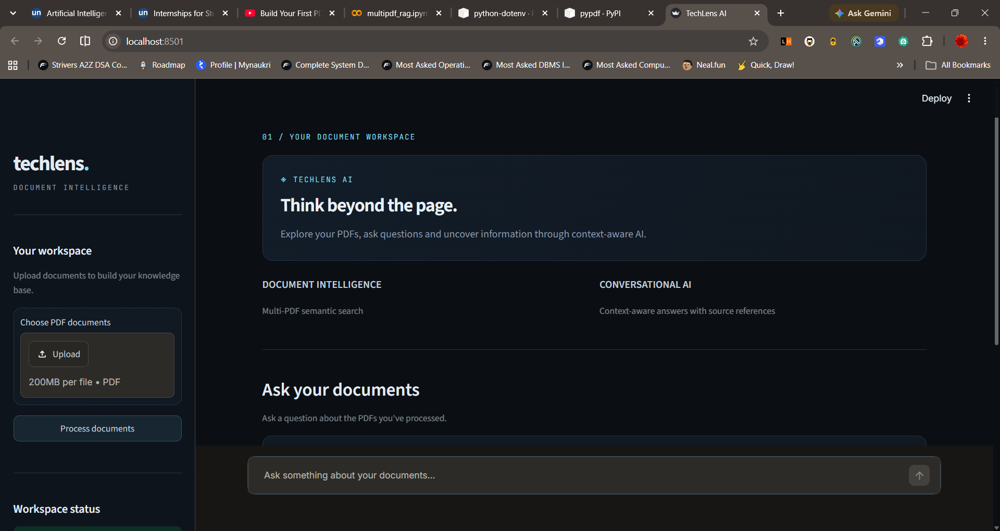
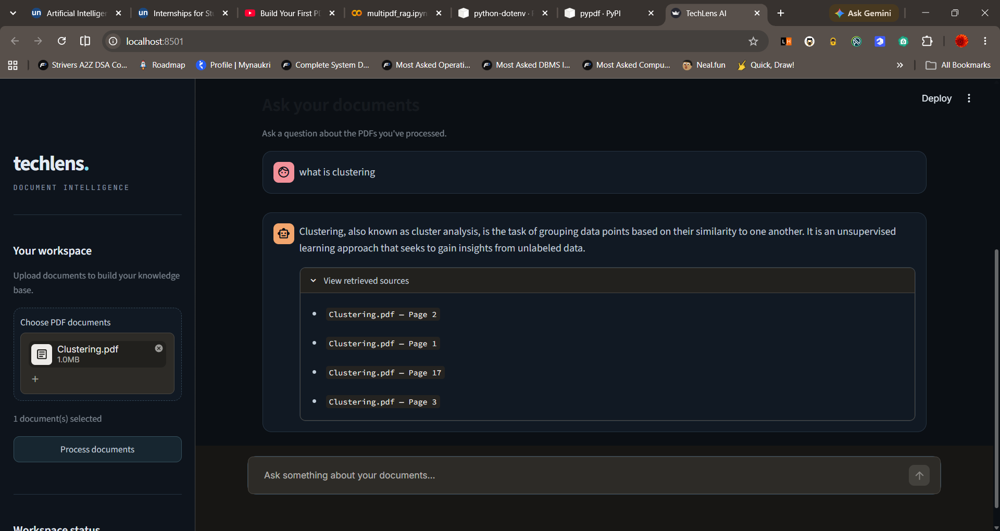
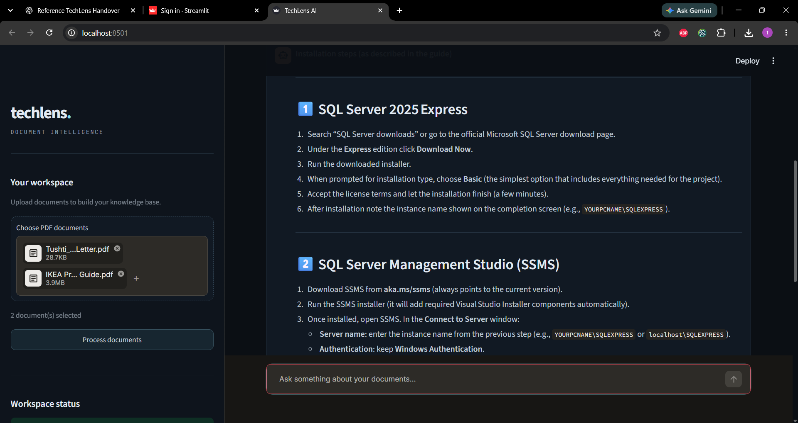
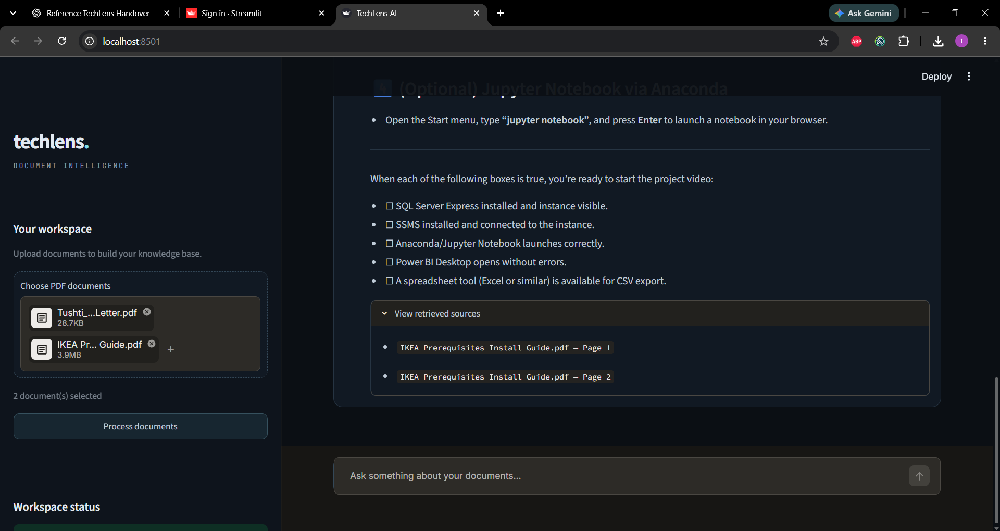

# TechLens AI

**Upload. Ask. Understand.**

TechLens AI is a multi-PDF conversational question-answering application built using Retrieval-Augmented Generation (RAG). It allows users to upload PDF documents, ask questions in natural language, and receive context-grounded answers with references to the source document and page.

## Screenshots

### Home Interface


### PDF Upload and Processing


### Document Q&A


### Source References


## Features

- Upload and process multiple PDF documents.
- Extract text and split it into overlapping chunks.
- Generate semantic embeddings using Google Gemini.
- Store and retrieve relevant document chunks using FAISS.
- Generate answers using a Groq-hosted language model.
- Maintain conversation context for follow-up questions.
- Display source document names and page references.
- Handle questions when the requested information is not found in the uploaded documents.

## Technology Stack

| Component | Technology |
|---|---|
| Programming language | Python |
| User interface | Streamlit |
| PDF extraction | PyPDF |
| Text chunking | LangChain |
| Embeddings | Google Gemini |
| Vector database | FAISS |
| LLM inference | Groq |
| RAG orchestration | LangChain |

## Architecture

```text
PDF Upload
    ↓
Text Extraction (PyPDF)
    ↓
Text Chunking (LangChain)
    ↓
Gemini Embeddings
    ↓
FAISS Vector Store
    ↓
Similarity Search
    ↓
Relevant PDF Context
    ↓
Groq LLM
    ↓
Grounded Answer + Source References
```

## Project Structure

```text
multi_pdf_rag/
│
├── app.py
├── requirements.txt
├── .env.example
├── .gitignore
├── README.md
│
├── screenshots/
│   ├── home.png
│   ├── pdf-upload.png
│   ├── chat.png
│   └── sources.png
│
└── faiss_index/       # Generated locally; not committed
```

## Getting Started

### 1. Clone the repository

```bash
git clone https://github.com/TushtiSavarn/TechLens-AI.git
cd TechLens-AI
```

### 2. Create a virtual environment

```bash
python -m venv venv
```

Activate it:

**Windows PowerShell**
```powershell
.\venv\Scripts\Activate.ps1
```

**macOS / Linux**
```bash
source venv/bin/activate
```

### 3. Install dependencies

```bash
pip install -r requirements.txt
```

### 4. Configure API keys

Create a `.env` file in the project root using `.env.example` as a template.

Add your own API credentials:

```env
GROQ_API_KEY=your_groq_api_key
GEMINI_API_KEY=your_gemini_api_key
GROQ_MODEL=openai/gpt-oss-120b
```

Never commit your `.env` file or share your API keys publicly.

### 5. Run the application

```bash
python -m streamlit run app.py
```

The application will open in your browser.

## How It Works

1. Users upload one or more PDF documents.
2. TechLens AI extracts readable text and retains document and page metadata.
3. The extracted text is divided into overlapping chunks.
4. Gemini converts the chunks into vector embeddings.
5. FAISS stores the embeddings and retrieves relevant chunks for each question.
6. LangChain passes the retrieved context and conversation history to the Groq-hosted language model.
7. The application displays the generated answer along with references to retrieved source pages.

## Important Notes

- API keys must be configured locally in `.env`.
- The FAISS index is generated locally when documents are processed.
- Uploaded PDFs and generated indexes are excluded from version control.
- Answer quality depends on the readability of the uploaded PDFs and the relevance of retrieved chunks.
- Source references identify retrieved document chunks; they should not be interpreted as independent verification of every statement in an answer.

## Future Improvements

- Improved retrieval and document ranking.
- More detailed source citations.
- Persistent document management.
- Evaluation of retrieval relevance and answer accuracy.
- Support for additional document formats.

## Author

**Tushti Savarn**

MCA Student | AI/ML Enthusiast | Software Developer

- **GitHub:** [TushtiSavarn](https://github.com/TushtiSavarn)
- **LinkedIn:** [Tushti Savarn](https://www.linkedin.com/in/tushti-savarn/)
- **Medium:** [@tushtisavran](https://medium.com/@tushtisavran)
- **Email:** [tushtisavran@gmail.com](mailto:tushtisavran@gmail.com)

---

*Built with Python, RAG, and a curiosity for intelligent document understanding.*
